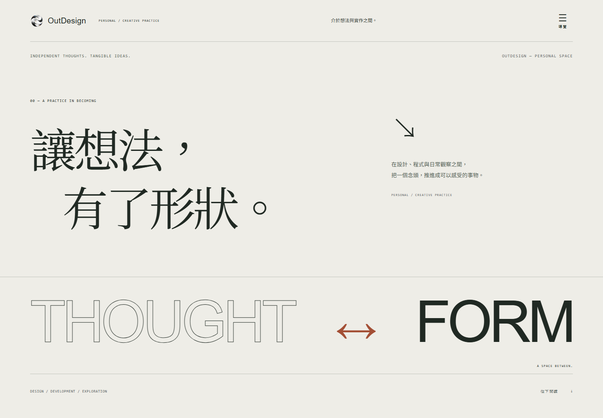

# OutDesign

月面景深、磨砂玻璃與克制虹彩的五頁個人網站，保留原本首頁卡片並使用新的莫比烏斯品牌圖標。附有工程藍圖積木編輯器、交互設定與右側即時代碼預覽。作者輸入 **兩組不同的密碼**，由後端驗證後才可讀取草稿或修改內容。訪客只看到已發布版本。



## 本機開啟

需求：Node.js 24、pnpm 11。

```sh
pnpm install --frozen-lockfile
pnpm dev
```

開啟 `http://127.0.0.1:4321/`。頁尾按「作者模式」，或按 `Alt+E`。首次使用直接在畫面設定兩組不同、至少 16 個字元的密碼。之後每次輸入這兩組密碼即可登入。關閉或重新整理頁面後需重新登入。

Windows 也可直接執行 `start.cmd`；此電腦會自動使用 Codex 已提供的 Node／pnpm 執行環境。

本機服務只綁定 loopback。設定、草稿、素材儲存在 `.local/`，已排除 Git。**沒有預設密碼，也沒有可繞過驗證的前端管理開關。**

## 已實作

- 五個靜態頁面：首頁 `/`、作品 `/work/`、筆記 `/journal/`、關於 `/about/`、資源 `/resources/`，搭配右側抽屜導覽。
- 桌面與手機版；鍵盤導覽、原生 dialog、減少動態設定。
- 圖層模式：原始卡片、文字、圖像與新增物件共用藍色選取、自由拖曳、縮放、鎖定、顯示、刪除及復原；左側圖層支援排序與自訂群組嵌套，左右側欄可拖曳調整寬度。
- 獨立積木模式：左側為可縮放的工程藍圖工作區，右側依顏色分類物件、圖像、事件、移動、外觀、流程與變數；支援條件／否則、有限重複、腳本命名與複製、雙擊屬性及實際執行預覽。
- 右側「分頁名稱」可個別修改五個頁面的瀏覽器標題，發布後套用；原始內容與新增面板均可編輯，並保留可命名重用的組裝及即時代碼預覽。
- 直接調整全站色彩、圓角與面板邊框／陰影／效果；保留舊版設定相容性。
- 草稿自動儲存、手動儲存、撤銷／重做、JSON 備份與匯入。
- 圖片、音樂、PDF／ZIP／TXT 上傳；圖片必要時縮至長邊 1800px 並轉 WebP。
- 明確發布、發布歷史、歷史版本載入草稿、建置失敗重試。
- 兩組密碼伺服器驗證、PBKDF2 雜湊、兩小時工作階段、登出撤銷、密碼變更使舊工作階段失效。
- 持久化登入限流；檔案 MIME／簽章／大小限制；草稿與私人素材不對訪客開放。

內建的三件作品均標示「概念示範」，聯絡信箱也明確標示為示範。請用自己的內容取代。SVG 與示範音訊是本專案原創素材。

共用快捷鍵：`Alt＋滾輪` 以游標為中心縮放、按住空格／中鍵拖曳平移、`Ctrl／Cmd＋Z` 復原、`Ctrl／Cmd＋Shift＋Z` 重做、`Ctrl／Cmd＋S` 儲存。積木模式右上附可縮放的裝置即時預覽，支援觸控拖曳與緊貼吸附；`Ctrl／Cmd＋D` 複製所選積木或腳本。

圖層模式快捷鍵：`V` 選取、`M` 移動、`H` 平移；`Delete` 刪除，方向鍵微調 1px，`Shift + 方向鍵` 微調 10px。從圖層列上半部／下半部放開可插入前方／後方；`Shift` 拖曳可將新增物件放入自訂群組。原始內容保留其網頁語意結構，刪除後可從圖層清單還原；新增群組支援最多六層，禁止循環。小螢幕會還原閱讀順序。

積木邏輯使用經後端驗證的宣告式指令，不執行任意 JavaScript。每個腳本最多 100 個積木、五層邏輯；重複最多十次，單次事件最多 500 步／30 秒。長指令鏈會讓出主執行緒，閒置時不持續渲染；預覽關閉後清理事件、動畫、觀察器與等待中的工作。公開頁面只有設定腳本後才載入邏輯執行器。

## 發布到 GitHub Pages

完整步驟見 [部署文件](docs/DEPLOYMENT.md)。GitHub Pages 承載靜態網站；Supabase 承載驗證、草稿與檔案。

1. 建立 Supabase 專案，依序套用 `supabase/migrations/` 中的 SQL 檔案。
2. 部署 `studio-api` Edge Function，設定兩組密碼雜湊及允許來源。
3. 將專案放到 GitHub，設定 Pages 的 Source 為 GitHub Actions。
4. 設定 `PUBLIC_API_URL`、`SITE_URL`、`BASE_PATH` 三個 Repository Variables。
5. 執行 Actions；成功後才視為上線。

可使用 `pnpm github:publish --repo outdesign-site --api https://PROJECT.supabase.co/functions/v1/studio-api` 發布至自己的空白儲存庫。工具使用隱藏輸入或環境變數提供 GitHub 憑證；不把憑證存檔或放入網址。

**尚未設定後端時，靜態建置只提供概念展示，作者入口會清楚顯示尚未連線。** 本機完整編輯功能可直接使用。

## 驗證

```sh
pnpm check
pnpm test
# Windows 使用已安裝的 Edge；Linux / CI 先執行下一行。
pnpm exec playwright install --with-deps chromium
pnpm test:e2e
pnpm build
```

瀏覽器測試使用獨立的臨時資料庫及隨機密碼，不更動你的 `.local/`。報告與桌面、手機截圖位於 `artifacts/`。

## 專案結構

```text
src/components/         公開區塊與圖示（靜態 HTML）
src/editor/             點擊作者入口後才載入的 React 編輯器
src/styles/             視覺變數、響應式與編輯介面
supabase/functions/    共用驗證／API 與正式 Edge Function
supabase/migrations/   資料表、RLS、原子儲存與發布程序
server/                loopback 本機開發後端
scripts/               開發、驗證、密碼雜湊、GitHub 發布工具
tests/                 驗證、權限、草稿與檔案安全測試
.github/workflows/      自動驗證、建置、部署
```

作者工作區、積木模式、即時預覽、組裝預設及效能分析見 [工作區說明](docs/STUDIO.md)。

更多：[視覺設計](docs/DESIGN.md) · [安全與資料流程](docs/SECURITY.md) · [部署文件](docs/DEPLOYMENT.md) · [效能檢查](docs/PERFORMANCE.md)

交互與代碼工作區：選擇卡片效果、調整角度與阻尼，查看實際 TypeScript／CSS；以 `content.json` 批次編輯整站或以 `theme.css` 調整型別化視覺變數。任意 JavaScript／HTML 模板仍由 GitHub 原始碼修改。

作者工作區新增可巢狀面板、自由定位與縮放、水平／垂直／網格 Auto Layout、圖層複製／刪除、鎖定／隱藏、8px 吸附與裝置畫布。編輯時封鎖訪客功能，預覽時恢復。左側頁面／圖層自動決定右側屬性；內容、風格、媒體、互動、佈局面板皆提供獨立 JSON 程式碼編輯。

2026-10-21 作者工作區：工程藍圖積木庫、拖放組合、點選內容定位、元素樣式與介面文案編輯，以及展開代碼時的右側即時預覽。正式部署需先更新 studio-api schema 與 presentation media migration，見部署文件。
